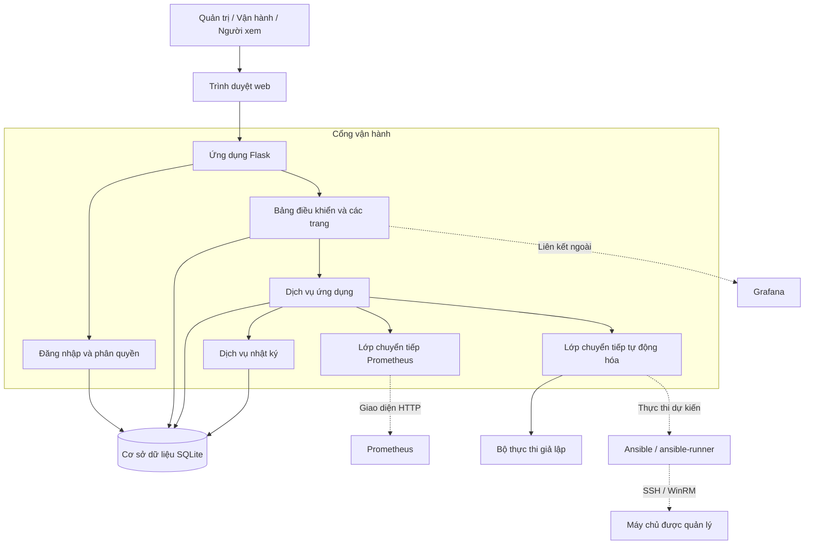

# Sơ đồ kiến trúc ứng dụng

## Tổng quan

Cổng vận hành là một ứng dụng Flask nguyên khối. Ứng dụng lưu trạng thái tại chỗ trong SQLite và nói chuyện với hệ thống giám sát, hệ thống tự động hóa qua các lớp chuyển tiếp. Bộ thực thi mặc định là `mock`, nên cổng vẫn chạy an toàn khi không có Prometheus, Grafana hoặc Ansible.

## Trách nhiệm từng lớp

| Lớp | Trách nhiệm |
| --- | --- |
| Các trang Flask | Đường dẫn cho bảng điều khiển, máy chủ, cảnh báo, tự động hóa, nhật ký và đăng nhập. |
| Đăng nhập và phân quyền | Phiên đăng nhập và quyền `admin`, `operator`, `viewer`. |
| Dịch vụ | Truy vấn Prometheus khi cần, đồng bộ cảnh báo thủ công, quy tắc khắc phục, điều phối công việc và bản ghi nhật ký. |
| Bộ thực thi | Hành động nằm trong danh sách cho phép, mặc định chạy giả lập. Ansible là điểm mở rộng. |
| SQLite | Kho máy chủ, cảnh báo, công việc tự động hóa, người dùng và lịch sử nhật ký. |
| Hệ thống bên ngoài | Prometheus cung cấp số liệu và cảnh báo. Grafana được mở từ bảng điều khiển. Ansible sẽ chạy các playbook được kiểm soát. |

## Luồng khi chạy

1. Người dùng đăng nhập rồi vào bảng điều khiển hoặc các trang quản lý.
2. Bảng điều khiển hỏi Prometheus qua lớp chuyển tiếp. Số liệu không lấy được thì hiện `N/A`.
3. Lệnh `sync-prometheus-alerts` đưa cảnh báo Prometheus vào SQLite và có thể tạo một công việc khắc phục nằm trong danh sách cho phép khi tính năng này được bật.
4. Người vận hành gửi một hành động tự động hóa được cho phép. Bộ thực thi giả lập mặc định ghi lại kết quả xác định và một sự kiện nhật ký.
5. Trang nhật ký đọc lịch sử đã lưu trong SQLite.
