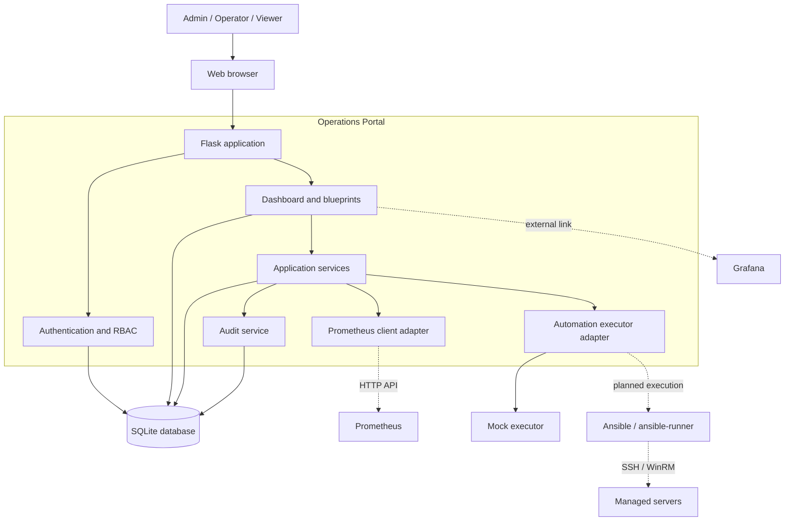

# Application Architecture Diagram

## Overview

The Operations Portal is a Flask monolith. It stores local state in SQLite and communicates with monitoring and automation systems through adapters. The default executor is `mock`, so the portal runs safely without Prometheus, Grafana, or Ansible.

## Responsibilities

| Layer | Responsibility |
| --- | --- |
| Flask blueprints | Routes for dashboard, servers, alerts, automation, audit, and authentication. |
| Authentication and RBAC | Session login and `admin`, `operator`, and `viewer` permissions. |
| Services | On-demand Prometheus queries, manual alert synchronisation, remediation rules, job orchestration, and audit records. |
| Executors | Allow-listed actions with mock execution by default; Ansible is an extension point. |
| SQLite | Operational inventory, alerts, automation jobs, users, and audit history. |
| External systems | Prometheus supplies metrics/alerts; Grafana is linked from the dashboard; Ansible will execute controlled playbooks. |

## Runtime Flow

1. A user signs in and accesses the dashboard or management pages.
2. The dashboard queries Prometheus through the adapter; unavailable metrics are shown as `N/A`.
3. `sync-prometheus-alerts` imports Prometheus alerts into SQLite and may create an allow-listed remediation job when enabled.
4. An operator submits an allow-listed automation action; the default mock executor records a deterministic result and audit event.
5. The audit page reads persisted history from SQLite.
