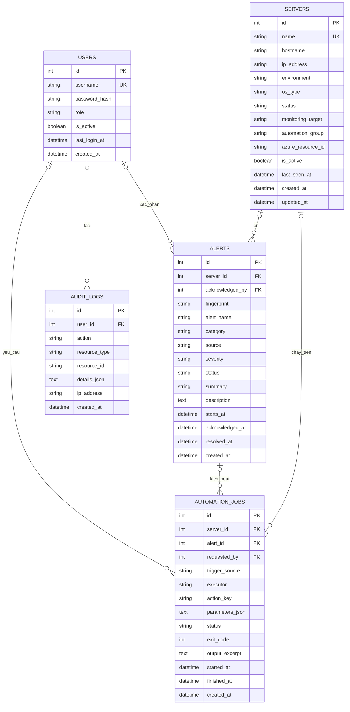

# Sơ đồ thực thể

## Quy tắc dữ liệu

- Một máy chủ có nhiều cảnh báo và nhiều công việc tự động hóa. Khóa ngoại của chúng được đặt thành `NULL` nếu máy chủ bị xóa.
- Một cảnh báo do một người dùng xác nhận và có thể gắn với nhiều công việc khắc phục.
- Một công việc tự động hóa được tạo cho một máy chủ, và có thể xuất phát từ một cảnh báo cùng một yêu cầu của người dùng.
- Bản ghi nhật ký giữ người thực hiện khi có thông tin đó, và giữ lịch sử hành động không bị sửa.
- SQLite bật kiểm tra khóa ngoại. Bản nâng cấp cơ sở dữ liệu đánh chỉ mục các cột thường được lọc.

Tên cột trong sơ đồ giữ đúng tên trong cơ sở dữ liệu. Năm bảng là `users`, `servers`, `alerts`, `automation_jobs` và `audit_logs`.
