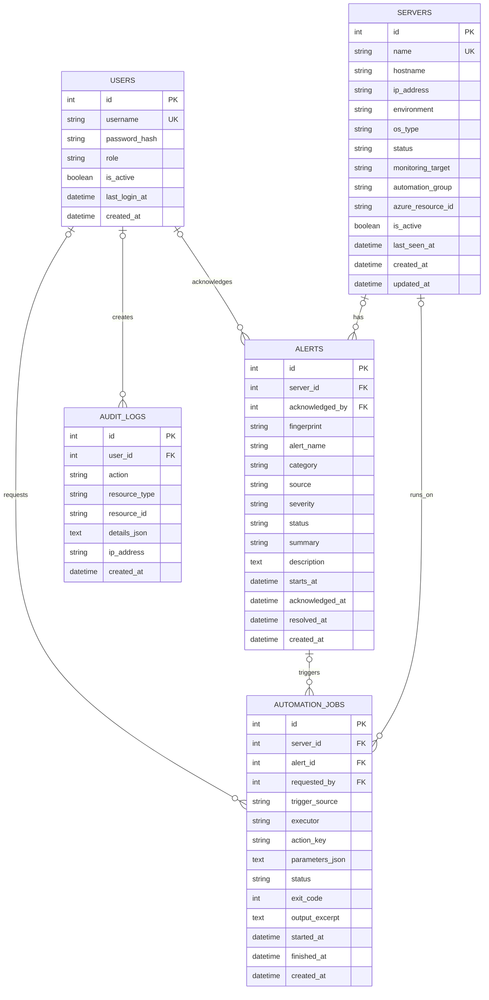

# Entity Relationship Diagram

## Data Rules

- A server can have many alerts and automation jobs; their foreign keys are set to `NULL` if a server is removed.
- An alert can be acknowledged by one user and associated with multiple remediation jobs.
- An automation job is created for one server and can optionally originate from an alert and user request.
- Audit records keep the actor when available and preserve an immutable action history.
- SQLite foreign-key enforcement is enabled; the migration indexes commonly filtered columns.
